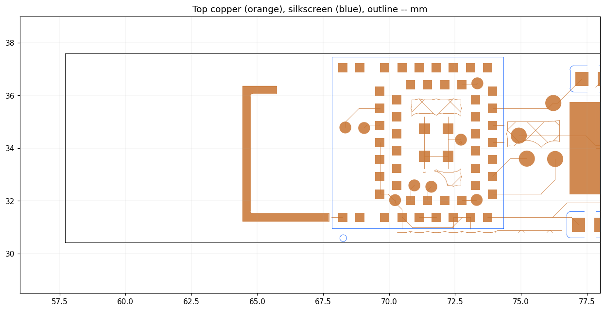
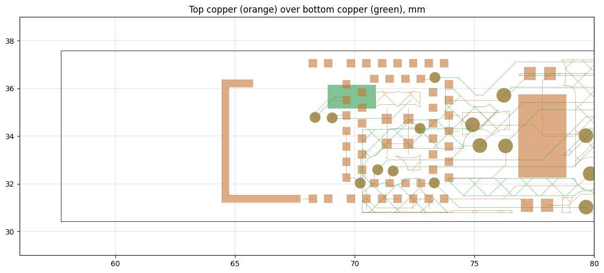

# Antenna: what is there, and how to tune it without a VNA

Written 2026-10-15 from the 2026-08-21 netlist and the Gerbers in
`../_gerber_check/YG/PCB_11402192A_Y61.zip`. Renders are in `docs/`, made with
`tools/gerber_render.py`. **If a later board revision added matching pads,
the "existing boards" section does not apply to it.**

## What the board has

**There is no pi matching network.** The netlist joins `U5.5` (`ANT_INT`) and
`U5.6` (`ANT`) directly, with nothing else on the net. That is the ANNA-B402's
internal-antenna option: the module's 50 Ω RF pin feeds its own chip antenna,
with matching inside the module. Both pins sit **under the LGA module**, so on
this board there is nowhere to insert a series or shunt part, even as a bodge.

**The tuning element is a copper strip, `ANT_PCB`.** The datasheet requires
the internal antenna to be completed by a strip on the carrier board. This
board uses the "module in a corner" option: pin 1 (`ANT_PCB`, net
`GND_Pattern`) drives a C-shaped strip to the left of the module:



| Part of the strip | Length (centreline) |
|---|---|
| Feed from pin 1 (0.25 mm trace) | ~0.4 mm |
| Bottom run, leftward | ~3.4 mm |
| Vertical run, upward | ~5.0 mm |
| Top stub, back to the right (open end) | ~1.2 mm |
| **Total** | **~10 mm**, 0.29 mm wide |

Pins 2-3 (`ANT_GND1`/`ANT_GND2`, the "middle of a side" option) are
unconnected, consistent with the corner option. The bottom layer is
correctly clear under the strip:



## Why it is ~17 dB down

These are measured: the ring read -79 dBm median and the WHOOP on the same
body read -62, and a Windows link dropped at -80 to -89 dBm. The causes
below are reasoning, not measurement.

1. **Ground plane.** A chip antenna is tuned for the ground plane on the
   module's reference board. This board is a 7 mm-wide flex strip with
   hatched ground: far smaller and differently shaped. A small ground both
   detunes the antenna and cuts its efficiency.
2. **The finger.** Tissue is lossy and has high permittivity. It absorbs
   power and pulls the resonance down. That is likely why "tuned down to
   2.2-2.3 GHz" is a plausible description.
3. **Strip geometry.** The strip's length was presumably taken from a
   reference design meant for a rigid board, not for a curved ring on a
   finger.

Tuning can win back the detuning part, maybe several dB. It cannot fix
absorption or a small ground. Expect an improvement, not parity with a
WHOOP.

## Tuning existing boards

The knobs, in order of how reversible they are:

| Change | Effect | Reversible? |
|---|---|---|
| Rotate the ring so the module sits on the back of the finger, not the palm side | Less tissue in the near field | Yes |
| **Extend the strip**: solder fine wire (e.g. 0.1 mm magnet wire) onto the open end of the top stub | Resonance **down** | Yes, unsolder it |
| **Shorten the strip**: cut across it with a scalpel, then scrape a gap ~0.2 mm wide | Resonance **up** | Only by bridging the cut |

If the antenna really is tuned low, **shortening is the fix**. Shorten in
small steps and measure after each one:

1. **Measure stock** first (see below). Without a baseline the rest means
   nothing.
2. **Test the direction cheaply** before cutting anything. Extend the stub
   by about 2 mm with wire and measure. If that is *worse*, the antenna is
   already too long, and shortening is right. If it is *better*, the
   antenna is too short. Keep the wire and try 3-4 mm.
3. **Cut 1:** remove the whole top stub (~1.2 mm). Cut it at the corner.
4. **Cut 2 onwards:** shorten the vertical run from its top, about 0.5 mm
   at a time. Stop when two cuts in a row bring no gain of 1 dB or more,
   then bridge the last cut back with solder if it made things worse.

There are no published numbers for how far one millimetre moves this
antenna. The direction test in step 2 replaces the VNA.

## Measuring: `tools/rssi_ab.py`

```bash
python tools/rssi_ab.py measure "stock"
```

```bash
python tools/rssi_ab.py measure "stub +2mm wire"
```

```bash
python tools/rssi_ab.py table
```

* Wear the ring and the WHOOP, with WHOOP heart-rate broadcast **on**.
  The tool scores **ring RSSI minus WHOOP RSSI**. Your body and the room
  affect both equally, so most of the noise cancels.
* It runs three positions per measurement, 30 s each, and appends to
  `antenna_sweep.csv`. `table` ranks everything measured so far.
* **2 dB or more is real; under about 1 dB is noise.** Repeat when two
  results are close.
* Close the dashboard and the phone app first: a connected ring does not
  advertise.

## Next board spin

These are proposals for the respin list (`HARDWARE_NOTES.md`):

1. **Put a pi network in reach.** Route `ANT` out from under the module
   through three 0201 footprints, a 0 Ω series part and two DNP shunts,
   then back to `ANT_INT`. That makes the tuning in `HARDWARE_NOTES` and the
   capacitor sweep from 2026-10-10 possible. Also add a pad to break the
   path for a conducted measurement with a U.FL adapter.
2. **Make the strip trimmable by design.** Extend it with a few
   solder-bridge links (0.5 mm apart), so length is set by bridging pads,
   not by cutting copper.
3. **Give it ground.** Use solid, not hatched, ground pour under the module
   and as wide as the flex allows. Check the ground-plane guidance in the
   ANNA-B4 system integration manual (UBX doc, ref [3] in the datasheet).
   It is not in this folder.
4. **Keep the module on the back of the finger**, away from the palm side,
   which holds the PPG anyway.
